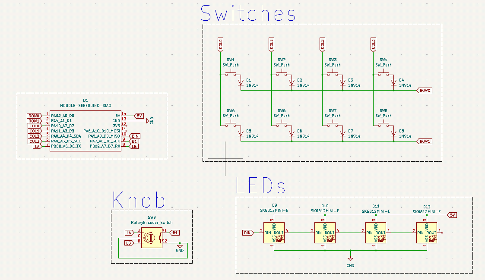
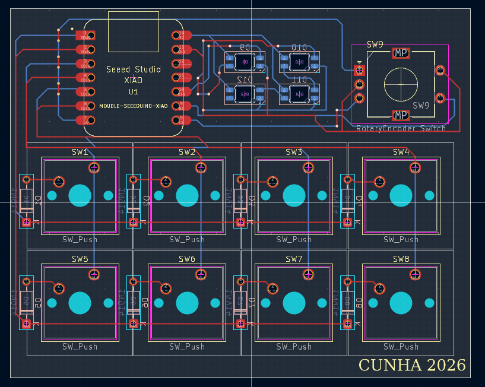
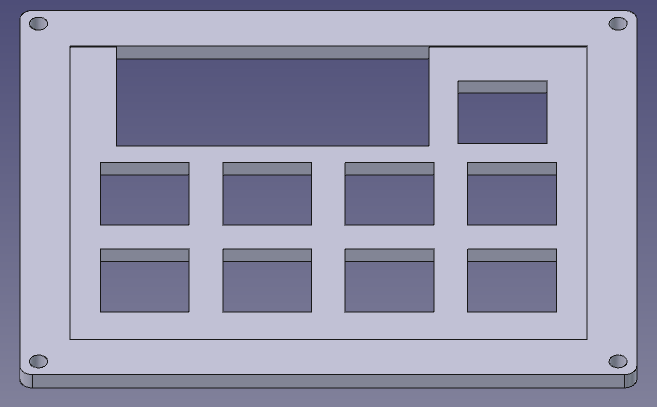
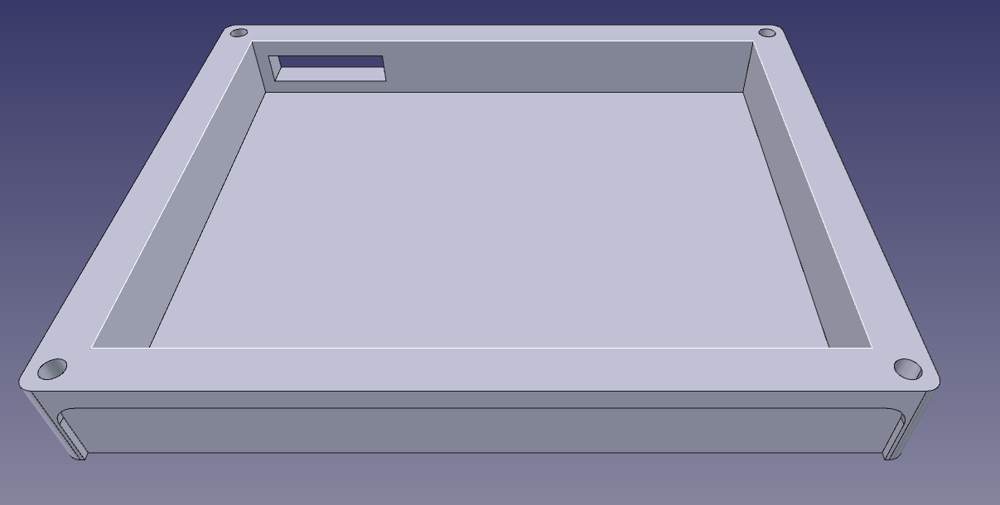

# HUMBLE, THE MACROPAD

## About the project

**Humble** is a compact macropad built from scratch: PCB, case and firmware. It was designed as my first hardware project, so the goal is to keep it simple and small, easy to understand and easy to build.

## Gallery

### Schematic

Here is the macropad schematic, made in KiCad.

### PCB

Here is the PCB, also designed in KiCad from the schematic.

### Top case

Here is the top part of the case, designed in FreeCAD, where the switches and the knob sit, along with the opening to see the LEDs and the microcontroller.

### Bottom case

And here is the bottom part of the case, also made in FreeCAD.

## BOM

| Qty | Component | Function |
| --- | --------- | -------- |
| 1 | Seeed XIAO RP2040 | Microcontroller |
| 1 | Alps EC11E | Knob (rotary encoder) |
| 8 | Cherry MX | Switches |
| 4 | SK6812MINI-E | LEDs |
| 8 | 1N914 | Diodes |